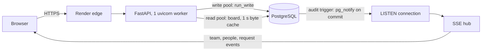

# Crewline

Form a hackathon team without double joins. When 50 people click Join on the last open seat at the same moment, exactly one gets it, and no retry, crash or overlapping action leaves the data invalid.

Hack4Hack Crew Hiring Challenge 2026, Problem Statement 1 (race-proof team formation for 10,000 participants).

[](https://github.com/nitheshkummarc/Crewline/actions/workflows/ci.yml)
[](https://github.com/nitheshkummarc/Crewline/actions/workflows/load.yml)

**Live:** https://crewline-20bm.onrender.com (Render free plan in Singapore with Neon PostgreSQL; the first request after 15 idle minutes takes about a minute while the service wakes up)

## Try it in 3 minutes

1. Open the live URL and sign in with a reviewer account: `user00000@example.com` or `user00001@example.com`, password `crewline-demo-1` (shared demo accounts on seeded data).
2. Open **Race lab** (`/lab`):
   - **How a join works** traces every SQL statement of a real join, in order, with timings.
   - **Last-seat race** sends N people at one open seat at once: one winner, everyone else `team_full`, read back from the database.
   - **Spam clicks** has one person press Join many times: one membership.
3. Open the board in two browsers. A join, leave or new team in one shows up in the other without a refresh.

## How the guarantee works

A seat is taken by one conditional statement inside the same transaction as the membership insert:

```sql
UPDATE teams SET member_count = member_count + 1, version = version + 1
WHERE invite_code = $1 AND invite_expires_at > now()
  AND status = 'forming' AND member_count < max_size
RETURNING id, hackathon_id, member_count, version;
```

Under READ COMMITTED the other 49 requests wait on that row's lock, re-check `member_count < max_size` against the committed row, match nothing and get `409 team_full`. A unique index stops one person joining two teams, the `teams_cap` constraint (`CHECK (member_count BETWEEN 1 AND max_size)`) backs up the predicate, and every write path takes locks in one order, so a join and a leave cannot deadlock. Every mutation carries an `Idempotency-Key` claimed as the first statement of its transaction, so a retried click replays the original answer instead of acting twice.



## How it is proven

| Claim | Proof |
|---|---|
| Exactly one winner per seat | 50-way last-seat race through a real server with a 60-connection pool, 20 rounds, on PostgreSQL 16 and 18 in every CI run |
| The race test can detect a race | A naive check-then-insert join run by the same test lets several people in. With the seat predicate deleted on a test branch, CI went red: 50 of 50 racers got one seat ([T-OPS-04](docs/verification.md)) |
| Retries never double-apply | Same-key replays return identical bytes, including a retry racing its own original (T-RACE-10, 11, 16) |
| Crashes leave valid data | Chaos test hard-kills the API 3 times under 23,012 join actions: 0 errors, 0 replay mismatches, 0 teams over capacity ([verification.md](docs/verification.md) section 7) |
| Data is always valid | 10 invariant queries (`database/invariants.sql`) return zero rows after every test module, load run and chaos run |
| Fast under load | Board p95 under 200 ms at 100 concurrent users, measured with k6 on every push ([load report](docs/load-report.md)) |

## Run it locally

With Docker:

```
docker compose up -d --build                                   # PostgreSQL 16 + API on http://localhost:8000 (or: make up)
docker compose exec api python database/seed.py --users 300 --teams 40
```

Without Docker (PostgreSQL 16 binaries from the `pgserver` package; uv from `pip install uv`):

```
uv sync --project backend
uv run --project backend pytest backend/tests -q              # starts a test database, runs all 110 backend tests
uv run --project backend python database/dev_db.py start       # local dev database, prints DATABASE_URL
```

All commands (Make targets and their raw equivalents for Windows) are listed under [Commands](#commands).

## Tests

| Suite | Where | Count | In CI |
|---|---|---|---|
| API and unit | `backend/tests/api`, `backend/tests/unit` | 89 | PostgreSQL 16 and 18 |
| Races, negative control, guarantees | `backend/tests/concurrency` | 21 | PostgreSQL 16 and 18, 20 rounds |
| Web (Vitest) | `frontend/src/**/*.test.ts(x)` | 70 | yes |
| End-to-end (Playwright, 360 px and 1280 px) | `frontend/e2e` | 10 flows, 20 runs | yes |
| Load (k6) | `loadtest/` | L-A1, L-A2, L-B, L-C | smoke on every push, full runs in `load.yml` |
| Docker Compose smoke | `.github/scripts/compose-smoke.sh` | signup, register, create team | yes |

Every test ID and what it proves: [docs/verification.md](docs/verification.md).

## Project layout

```
backend/app/        FastAPI service: core/ (errors, deps, rate limits, events), db/ (pools, run_write, listener), modules/<feature>/ (router, service, repo, schemas)
backend/tests/      api/, concurrency/ (races, negative control), unit/
backend/scripts/    chaos test, latency probe, SSE listeners for load runs
database/           SQL migrations, migration runner, invariant checker, seed, local PostgreSQL
frontend/           React + TypeScript app (src/), Playwright flows (e2e/), see frontend/README.md
loadtest/           k6 scenarios: board.js (L-A), mixed.js (L-B), soak.js (L-C)
docs/               design, architecture, decisions, API, verification, load report, bug diary, plan
```

## Decisions and trade-offs

| Chose | Over | Why |
|---|---|---|
| Conditional `UPDATE` as the seat guard | Check-then-insert, Redis locks, SERIALIZABLE, `SKIP LOCKED` seat rows | One exact statement; a team has at most 10 seats, so serializing on one row is cheap ([ADR-005](docs/decisions.md#adr-005)) |
| PostgreSQL as the only store | Redis or a queue | One commit covers seat, member, audit row and stored response ([ADR-003](docs/decisions.md#adr-003), [ADR-022](docs/decisions.md#adr-022)) |
| Every business check after the idempotency claim | Fast "team full" pre-checks | A pre-check made a retry racing its own original return 409 to the person who got the seat (bug B-7) ([ADR-013](docs/decisions.md#adr-013)) |
| Events from an audit trigger with `pg_notify` | Publishing from application code | Delivered only on commit, so no event for a rolled-back change ([ADR-017](docs/decisions.md#adr-017), [ADR-019](docs/decisions.md#adr-019)) |
| Python + FastAPI | The organizers' Node.js stack | Faster to build and explain within 5 days; allowed if defended ([ADR-002](docs/decisions.md#adr-002)) |

All 40 decisions with rejected alternatives: [docs/decisions.md](docs/decisions.md). Real bugs found while building, each with how its cause was proven and its regression test: [docs/bug-diary.md](docs/bug-diary.md).

## Known gaps

No CAPTCHA at signup (a form token and a honeypot stop simple scripts) · logout does not revoke a token before it expires · rate limits live in each worker's memory · no organizer UI (hackathons come from seed or CLI) · the free host sleeps after 15 idle minutes.

## Docs

| Topic | Where |
|---|---|
| One-page design | [docs/design.md](docs/design.md) |
| Architecture, schema, every transaction and its lock order | [docs/architecture.md](docs/architecture.md) |
| Decisions and rejected alternatives | [docs/decisions.md](docs/decisions.md) |
| API reference and error codes | [docs/api.md](docs/api.md) |
| How each claim is proven | [docs/verification.md](docs/verification.md) |
| Load test results | [docs/load-report.md](docs/load-report.md) |
| Bugs found and fixed | [docs/bug-diary.md](docs/bug-diary.md) |

## Commands

On Windows without make, run the raw commands.

| Task | Raw command |
|---|---|
| PostgreSQL + API with Docker (`make up`, `make down`) | `docker compose up -d --build`, `docker compose down` |
| Local Postgres without Docker | `uv run --project backend python database/dev_db.py start` (prints `DATABASE_URL`; `stop` to stop) |
| Apply migrations | `uv run --project backend python database/migrate.py` |
| API dev server | `uv run --project backend uvicorn --factory app.main:create_app --reload --app-dir backend --no-proxy-headers` |
| All backend tests | `uv run --project backend pytest backend/tests` |
| Race and guarantee tests only | `uv run --project backend pytest backend/tests/concurrency -q` |
| Invariant checker | `uv run --project backend python database/invariants.py` |
| Lint and types | `uv run --project backend ruff check backend database` and, inside `backend/`, `uv run mypy app` (mypy reads its settings from backend/pyproject.toml) |
| Seed 10k users / 2k teams | `JWT_SECRET=... uv run --project backend python database/seed.py --url <db> --tokens loadtest/tokens.json` |
| Latency of every endpoint | `uv run --project backend python backend/scripts/latency_probe.py --base <api> --server-log <api log>` |
| Chaos test (kills the API 3 times) | `uv run --project backend python backend/scripts/chaos.py` |
| Load tests (k6) | `k6 run -e BASE_URL=<api> loadtest/board.js` (also `mixed.js`, `soak.js`); L-B also needs `uv run --project backend python backend/scripts/sse_listeners.py --base <api>` running alongside |
| Web contrast check | `node frontend/scripts/contrast.mjs` |
| Web: install, dev server | `npm --prefix frontend ci`, `npm --prefix frontend run dev` |
| Web: type check, lint, tests, build | `npm --prefix frontend run typecheck`, `npm --prefix frontend run lint`, `npm --prefix frontend test`, `npm --prefix frontend run build` |
| Web: end-to-end (needs a running API, see frontend/README.md) | `npm --prefix frontend run e2e` |

Run `npm --prefix frontend run build` before starting the API to serve the web app at `/`.

## Stack

FastAPI (Python 3.11+, asyncpg, raw SQL) · PostgreSQL 16 locally, 18 on Neon (CI tests both) · React + TypeScript + TanStack Query · SSE · k6 · Docker Compose · GitHub Actions · Render + Neon (Singapore).
