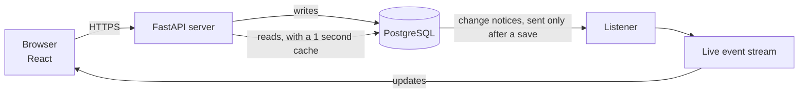

# Crewline

Team formation for a 10,000-person hackathon. When 50 people click Join on the last open seat at the same moment, exactly one gets it.

Built for the Hack4Hack Crew Hiring Challenge 2026, Problem Statement 1.


[](https://github.com/nitheshkummarc/Crewline/actions/workflows/ci.yml)
[](https://crewline-20bm.onrender.com)

## The problem

A team has 4 seats and 3 are taken. Fifty people click Join in the same second.

The simple way to build a join is: look at the team, see a free seat, add the person. All fifty requests look before any of them adds, all fifty see a free seat, and all fifty get in. A team of 4 ends up with 53 people.

Real traffic breaks things in other ways too:

- a slow network makes the browser send the same click twice
- one person joins two teams from two browser tabs
- a join and a leave on the same team get stuck waiting for each other
- the server crashes halfway, so a seat is counted but nobody is in it

The task was to let people create teams, join by invite code or by request, leave, and watch a live board, with none of these problems, for 10,000 participants.

## What it does

- Sign up, register for a hackathon, and mark yourself as looking for a team
- Create a team and share its invite code or QR code
- Join by code, or send a request that the leader accepts or declines
- Leave, remove members, and finalize the team
- A live board of teams and people, with skill filters and teammate suggestions
- A Race lab page that runs the last-seat race on the real database, so you can watch it work

## Try it

Live: https://crewline-20bm.onrender.com (free host, so the first visit after 15 quiet minutes takes about a minute to wake up)

1. Sign in as user00000@example.com or user00001@example.com, password crewline-demo-1.
2. Open Race lab and run the last-seat race. One person wins and everyone else is told the team is full.
3. Open the board in two browsers. Join a team in one and watch the other update by itself.

## How it works

### Architecture



There is one server and one PostgreSQL database, and nothing else: no Redis, no queue. Every rule lives in the database, so nothing breaks if the server restarts.

### Taking the last seat

The check "is there a free seat?" and the step "take it" happen in one single database instruction, so nothing can sneak in between them.

When fifty of these arrive together, the database lets one through at a time. The first takes the seat. Each of the others then checks again against the updated team, finds it full, and gets a "team full" answer.

The person is added to the team in the same save as the seat count. If anything fails partway, the whole thing is undone, so a seat can never be counted without a member.

Two database rules act as a safety net: a team can never have more members than its size, and one person can only be in one team per hackathon.

### Retries

Every click carries a unique key. The server saves that key, the change and the answer together. If the same click arrives again, the server finds the key and sends back the saved answer instead of acting twice.

The server never answers "team full" before it has saved the key. An early version did, and it told the person who actually won the seat that they had lost.

### Getting stuck

Every action locks things in the same fixed order. Two actions may wait for each other, but they can never end up waiting in a circle forever.

### Live board

Every change is written to a history log in the same save. The database announces a change only after the save succeeds, and the server passes it to every open browser. A change that was undone is never announced.

## Engineering decisions

| Decision | Instead of | Why |
|---|---|---|
| Check and take the seat in one database instruction | Check first, then add | No gap for another request to slip into. A team has at most 10 seats, so waiting your turn is quick |
| PostgreSQL as the only store | Adding Redis or a queue | One save covers the seat, the member, the history entry and the saved answer |
| Every "team full" style decision made after the click's key is saved | A quick check up front | A retry must always get the original answer |
| Live updates sent by the database after a save | Sent by the server code | Undone changes are never shown to anyone |
| Busy server answers "try again in a second" | Making people wait in a queue | Nobody hangs; the browser retries the same click safely |

All 40 decisions, with the options turned down and why: [docs/decisions.md](docs/decisions.md).

## How we know it works

| Claim | How it was checked |
|---|---|
| One winner per seat | 50 people race for one seat, 20 times in a row, on two PostgreSQL versions, on every code push |
| The test really catches races | A deliberately naive join fails the same test and lets several people in |
| Repeated clicks never act twice | A repeated click gets back exactly the same answer, even while the first one is still running |
| Crashes leave the data correct | The server was killed 3 times during 23,012 joins: no team over its size, no wrong answer to a retry |
| The data is always valid | 10 consistency checks run after every test, load run and crash test, and find nothing |
| Fast under load | The board answers in under 80 ms for 95 % of requests with 100 users at once on 10,000 users and 2,000 teams ([load report](docs/load-report.md)) |

**Attacked on purpose.** After the build, a separate test harness tried to break a frozen copy of the code: 1,215 different orderings of overlapping actions, slow network links, server kills and a database restart. The data never became invalid and nothing got stuck. It did find 9 smaller bugs, such as a profile edit at the same moment as a join showing old skills on the live board, and a dead database connection that made requests hang. Each one was reproduced, fixed at its cause, and covered by a new test. Full story: [docs/adversarial-testing.md](docs/adversarial-testing.md).

## Run it locally

With Docker:

```
docker compose up -d --build
docker compose exec api python database/seed.py --users 300 --teams 40
```

Then open http://localhost:8000.

Without Docker (needs uv and Node 22):

```
uv sync --project backend
uv run --project backend python database/dev_db.py start
uv run --project backend python database/migrate.py
uv run --project backend uvicorn --factory app.main:create_app --reload --app-dir backend --no-proxy-headers
npm --prefix frontend ci
npm --prefix frontend run dev
```

## Tests

| Suite | Count | Run with |
|---|---|---|
| Backend, on a real PostgreSQL | 96 | uv run --project backend pytest backend/tests/api backend/tests/unit |
| Races and crash recovery | 29 | uv run --project backend pytest backend/tests/concurrency |
| Web | 70 | npm --prefix frontend test |
| Full browser flows on phone and laptop sizes | 10 | npm --prefix frontend run e2e (see [frontend/README.md](frontend/README.md)) |
| Load | 4 scenarios | k6 run loadtest/board.js |

The full command list (consistency checker, crash test, big seed, lint) is in the Makefile and in [docs/verification.md](docs/verification.md).

Every source file starts with a short description and a Contents list of its functions. After changing a function, refresh the lists with uv run --project backend python backend/scripts/file_headers.py (CI fails if one is out of date).

## Project structure

| Folder | What is in it |
|---|---|
| backend/app | The server, one folder per feature |
| backend/tests | Server tests, race tests and crash tests |
| database | Database setup, consistency checker and demo data |
| frontend | The web app and its browser tests |
| loadtest | Load test scenarios |
| docs | Design, decisions, test plan, load results and bug history |

## Known gaps

- No CAPTCHA at signup. A hidden form field and a timing check stop simple bots.
- Logging out does not cancel the session token before it expires.
- Rate limits are kept per server process, not shared.
- No organizer screens. Hackathons are created from demo data.
- The free host sleeps after 15 quiet minutes.

## Docs

Start with the one-page [design](docs/design.md). Then read what you need:

| Doc | What you will find |
|---|---|
| [design.md](docs/design.md) | The whole design on one page, in plain words |
| [adversarial-testing.md](docs/adversarial-testing.md) | How the code was attacked, what held, what broke and how it was fixed |
| [decisions.md](docs/decisions.md) | 40 decisions, each with the options turned down |
| [bug-diary.md](docs/bug-diary.md) | Every real bug: how it was found, its cause, the fix |
| [load-report.md](docs/load-report.md) | Measured speed under load |
| [verification.md](docs/verification.md) | Every test and what it proves |
| [architecture.md](docs/architecture.md) | Technical spec: tables, every database step and lock order |
| [api.md](docs/api.md) | Technical spec: every endpoint and error |
| [requirements.md](docs/requirements.md) | The challenge requirements matched to the work |
